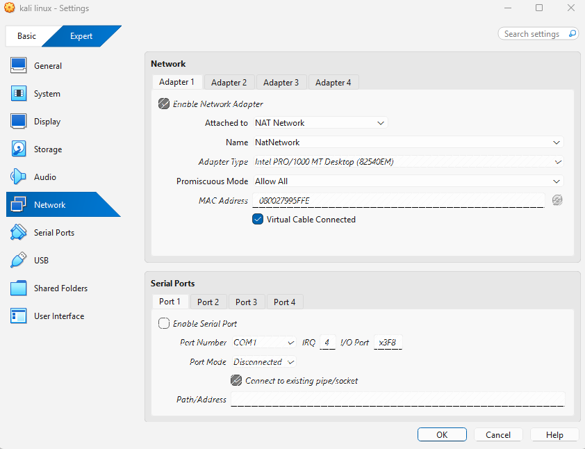
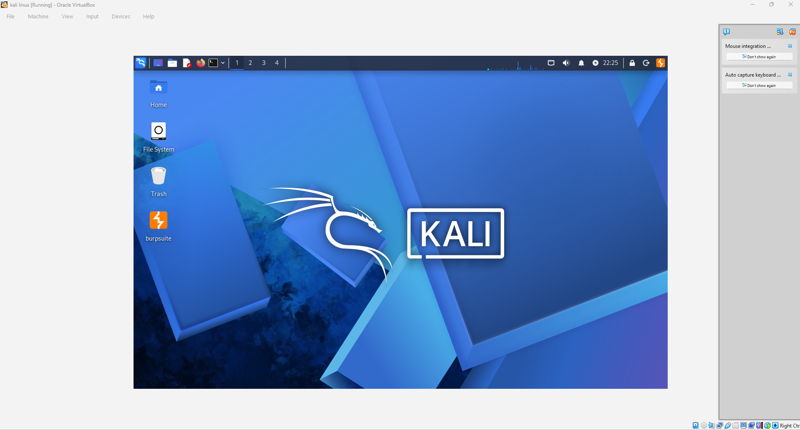
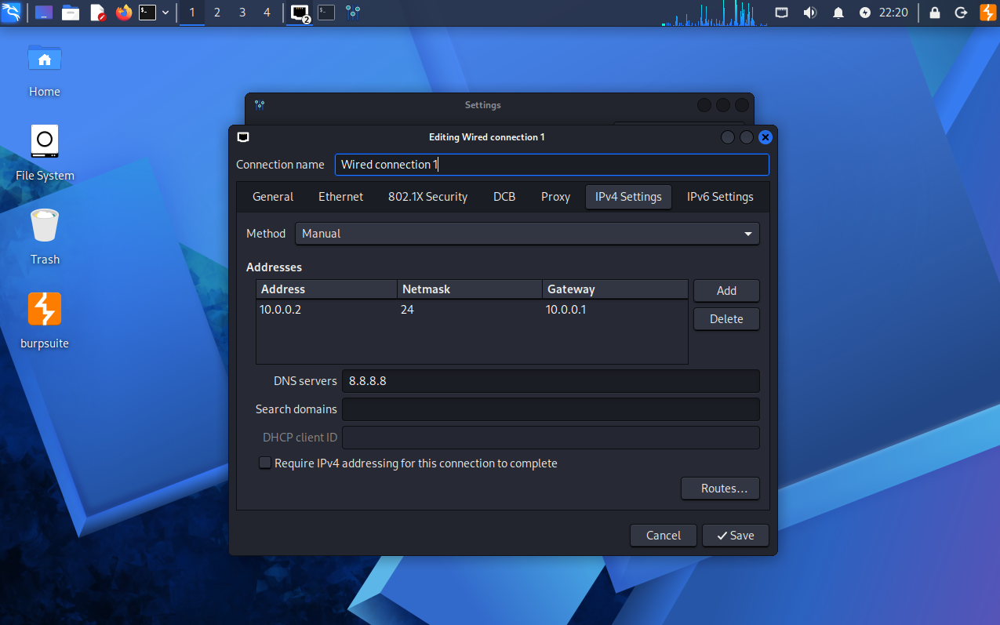

# 🔐 Cybersecurity Lab Setup

**NetworkWalks Cybersecurity Internship | Week 1**

A practical cybersecurity lab environment using Kali Linux and Oracle VirtualBox, with documented configuration and network connectivity verification.

---

## 📌 Project Overview

This project documents a cybersecurity lab environment running Kali Linux inside Oracle VirtualBox. It covers host system specifications, virtual machine configuration, network settings, basic connectivity testing, and troubleshooting.

The lab provides an environment for learning networking concepts and practicing cybersecurity techniques in an authorized setting.

## 🎯 Objectives

- Document the host system and virtualization environment.
- Identify the Kali Linux operating system version.
- Configure and document virtual network settings.
- Identify the network interface, IP address, and default gateway.
- Verify connectivity to the default gateway and an external IP address.
- Record troubleshooting activities and verification evidence.

## ⚙️ Lab Environment

### Host System

| Component | Details |
|---|---|
| Host Operating System | Windows 11 Pro |
| Host RAM | 8 GB |
| Processor | AMD Ryzen 5 |
| Hypervisor | Oracle VirtualBox 7.2.10 |

### Virtual Machine Configuration

| Component | Details |
|---|---|
| Guest Operating System | Kali GNU/Linux Rolling |
| Kali Linux Version | 2026.1 |
| Allocated RAM | 2471 MB |
| Network Mode | NAT Network |
| Network Interface | `eth0` |
| IPv4 Address | `10.0.0.2/24` |
| Default Gateway | `10.0.0.1` |
| DNS Server | `8.8.8.8` |

## 📸 Lab Setup Screenshots

### 1. Oracle VirtualBox Network Settings

The virtual machine's network adapter is configured to use NAT Network mode.



### 2. Kali Linux Virtual Machine

Kali Linux running inside the Oracle VirtualBox environment.



### 3. Kali Linux Network Configuration

The network configuration screenshot documents the IP address, gateway, and DNS settings.



## 🧪 Lab Verification

Network connectivity was checked using standard Linux networking commands.

### Step 1: Verify Operating System

**Command:**

```bash
cat /etc/os-release
```

**Observed details:**

- Distribution: Kali GNU/Linux Rolling
- Version: 2026.1
- Codename: kali-rolling

### Step 2: Inspect Network Interfaces

**Command:**

```bash
ip -br addr
```

**Observed `eth0` configuration:**

| Parameter | Result |
|---|---|
| Interface | `eth0` |
| Status | UP |
| IPv4 Address | `10.0.0.2/24` |

### Step 3: Inspect the Routing Table

**Command:**

```bash
ip route
```

**Observed route for `eth0`:**

```text
10.0.0.0/24 dev eth0
default via 10.0.0.1 dev eth0
```

The routing table also contained another default route through a separate interface. This README focuses on `eth0` as requested.

### Step 4: Verify Default Gateway Connectivity

**Command:**

```bash
ping -c 3 10.0.0.1
```

**Observed result:**

- Packets transmitted: 3
- Packets received: 3
- Packet loss: 0%

**Status:** Successful.

### Step 5: Verify External IP Connectivity

**Command:**

```bash
ping -c 3 8.8.8.8
```

**Observed result:**

- Packets transmitted: 3
- Packets received: 3
- Packet loss: 0%

**Status:** Successful.

### 6. Lab Verification Evidence

The following screenshot provides evidence of the network interface details and successful connectivity checks to the gateway and external IP address.


### Verification Summary

| Verification | Result |
|---|---|
| Operating System Identification | Verified |
| Network Interface Identification | Verified |
| IPv4 Address Identification | Verified |
| Default Gateway Connectivity | Successful |
| External IP Connectivity | Successful |

*Note: These results reflect the captured terminal output. DNS name resolution has not been independently verified.*

## 🛠️ Network Troubleshooting

The following NetworkManager commands were used during troubleshooting:

```bash
sudo nmcli connection modify "Wired connection 1" ipv4.dad-timeout 0
sudo nmcli connection down "Wired connection 1"
sudo nmcli connection up "Wired connection 1"
```

The captured terminal output showed that the connection was deactivated and subsequently activated.

### Troubleshooting Evidence


## 💡 Key Learnings

- Identifying the Kali Linux operating system and version.
- Understanding host and guest system configurations.
- Reviewing virtual network adapter settings in Oracle VirtualBox.
- Inspecting network interfaces and IPv4 addressing.
- Understanding default gateway configuration and routing.
- Using `ping` to verify network connectivity.
- Using Linux commands to inspect network configuration.
- Documenting troubleshooting steps and technical evidence.

## 🔐 Security and Ethical Considerations

- Perform security testing only on systems for which explicit authorization has been granted.
- Use controlled lab environments for cybersecurity practice.
- Follow responsible disclosure practices when identifying vulnerabilities.
- Avoid unauthorized access to networks, systems, or services.

## 📚 References

- [Kali Linux Official Website](https://www.kali.org/)
- [Oracle VirtualBox Official Website](https://www.virtualbox.org/)
- [NetworkWalks Sample Repository](https://github.com/waqaskarimccie/NETWORKWALKS-B082-WK1-PM1-CYBERSECURITY-LAB-SETUP-SAMPLE)

## 📌 Project Information

| Field | Details |
|---|---|
| Program | NetworkWalks Cybersecurity Internship |
| Week | Week 1 |
| Task | Cybersecurity Lab Setup |
| Platform | GitHub |

---

**Week 1 — Cybersecurity Lab Setup**

*Documenting the lab environment and verifying basic network connectivity as part of cybersecurity learning and practical skill development.*
